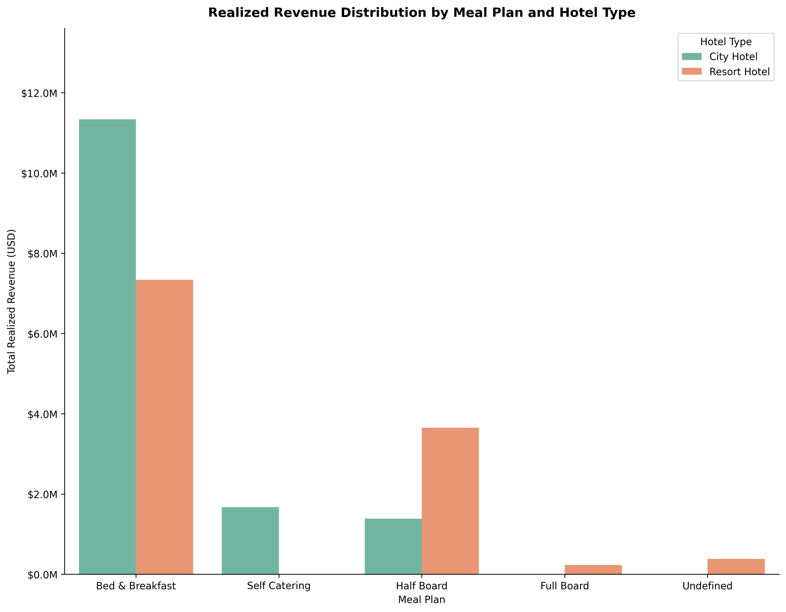

# Hotel Booking Demand & Revenue Risk Analysis

An end-to-end quantitative audit, data cleansing pipeline, and multidimensional business intelligence analysis evaluating **119,388 hotel reservations** across City and Resort properties. This project leverages **Pandas** for vectorized ETL alongside in-memory **DuckDB SQL** to diagnose cancellation drivers, evaluate channel profitability, and quantify gross revenue leakage.

---

## Executive Summary & Core KPIs

The analysis revealed an aggregate **cancellation rate of 37.04%**, representing over **$16.72M USD in gross revenue loss**. While City Hotel generates higher gross bookings, it carries disproportionate operational risk compared to Resort properties.

| Business Metric | City Hotel | Resort Hotel | Consolidated |
| :--- | :---: | :---: | :---: |
| **Total Bookings Audited** | 79,329 | 40,059 | 119,388 |
| **Cancellation Rate** | **41.73%** | 27.76% | 37.04% |
| **Average Daily Rate (ADR)** | \$105.24 | \$94.96 | \$101.79 |
| **Realized Revenue Generated** | \$14,394,410.18 | \$11,601,914.03 | **\$25,996,324.21** |
| **Gross Revenue Lost to Cancellations** | \$10,879,659.78 | \$5,842,177.34 | **\$16,721,837.12** |
| **Average Stay (Completed Nights)** | 2.92 nights | 4.14 nights | 3.43 nights |

---

## Visualizing Revenue Drivers by Meal Package

Bed & Breakfast (B&B) is the primary revenue generator for both properties ($11.33M in City Hotel and $7.34M in Resort Hotel). However, secondary demand patterns diverge significantly: urban corporate guests prioritize *Self Catering* (dining out in the city), while resort vacationers generate over $3.65M under *Half Board* (dining within the resort complex).

---

## Strategic Business Findings

### 1. The "Non-Refundable" Deposit Paradox
Reservations categorized under **"Non Refund" contracts exhibited an anomalous 99.36% cancellation rate** (14,493 cancellations out of 14,586 bookings). Cross-variable analysis confirmed that these records originated almost entirely from **offline wholesale agencies and tour operators** utilizing speculative block allocations rather than retail customer commitments.

### 2. Behavioral Indicators of Customer Commitment
* **Special Requests:** Booking cancellation risk decreases exponentially with customer engagement:
  * 0 Special Requests: **47.72%** cancellation rate.
  * 1–2 Special Requests: **~22.00%** cancellation rate.
  * 5 Special Requests: **5.00%** cancellation rate.
* **Car Parking Allocations:** Guests requesting 1 or more parking spaces registered a **0.00% cancellation rate** across the entire dataset.
* **Guest Loyalty:** Returning customers (*repeated guests*) cancel only **14.49%** of the time (vs. **37.78%** for first-time bookers), yet represent only **3.19%** of total demand, highlighting an underutilized retention opportunity.

### 3. Distribution Channel Economics & Friction
* **Direct Booking Channel:** The most profitable and reliable acquisition channel, showing only **15.34% cancellation** and the highest realized ADR (\$113.88).
* **Group Allocations:** High-friction segment showing a **61.07% cancellation rate** and an extreme average lead time of **187 days**, driving severe inventory holding costs.

---

## Data Pipeline Architecture

1. **Vectorized Cleansing (Pandas):**
   * Imputed structural nulls: `children` (0), `agent` (0), and `country` ('Unknown').
   * Purged uninformative features (`company` dropped due to >94% missingness).
   * Feature engineering: Extracted temporal dimensions (`status_year`, `status_day_name`) from `reservation_status_date`.
2. **Anomaly & Outlier Depuration:**
   * Filtered negative daily rates (`adr = -$6.38`).
   * Removed extreme erroneous outliers (`adr = $5,400.00` in City Hotel) via threshold boundary `(adr >= 0) & (adr < 5000)`, consolidating **119,388 clean records**.
3. **Analytical OLAP Queries (DuckDB SQL):**
   * Implemented Common Table Expressions (CTEs), multi-dimensional grouping, and `CASE WHEN` logic to segment lead times (<7 days: Last Minute, 7–30 days: Early Bird, >30 days: Long Term).

---

## Project Structure

~~~text
├── 01_hotel_booking_cleaning_and_eda.ipynb  # Main Jupyter Notebook (Pandas + DuckDB)
├── requirements.txt                         # Exact environment dependencies
├── revenue_by_meal_plan.png                 # Business intelligence visual asset
└── README.md                                # Executive summary and findings
~~~

---

## Reproducibility & Setup

~~~bash
# 1. Clone the repository
git clone https://github.com/luisferdm6/02-hotel-booking-demand-analytics.git
cd 02-hotel-booking-demand-analytics

# 2. Create virtual environment
python -m venv venv
source venv/bin/activate  # On Windows: venv\Scripts\activate

# 3. Install tested dependencies
pip install -r requirements.txt

# 4. Launch Jupyter
jupyter notebook
~~~
